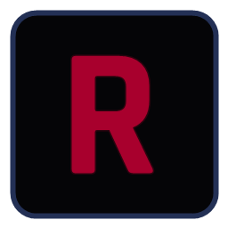
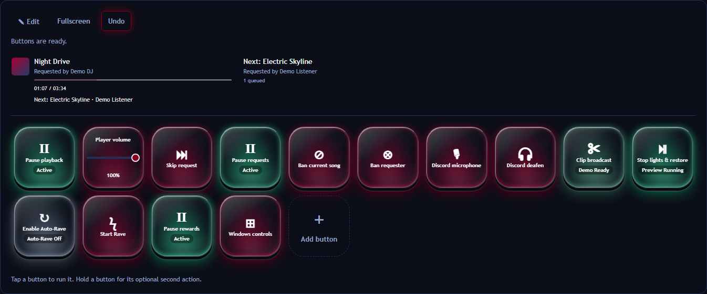
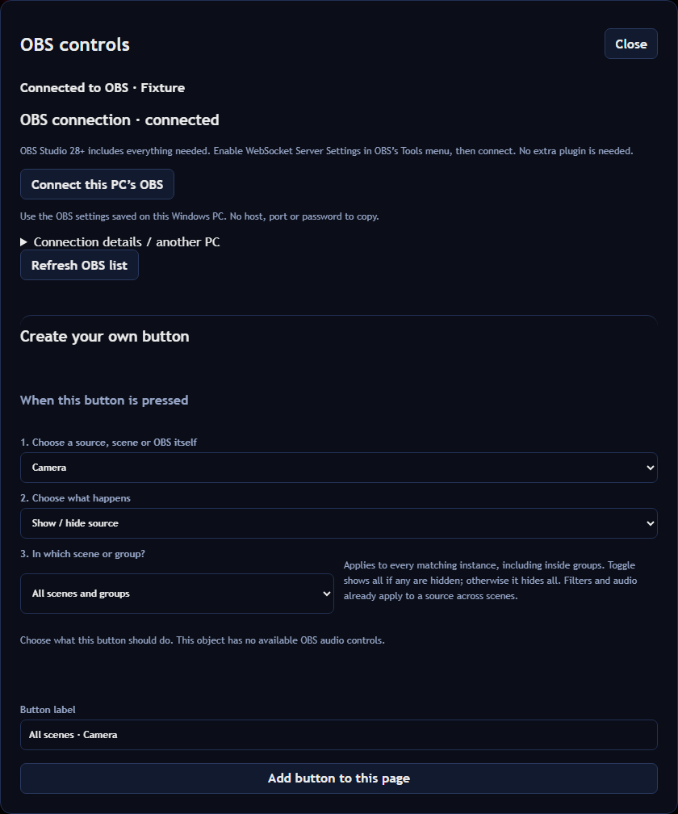
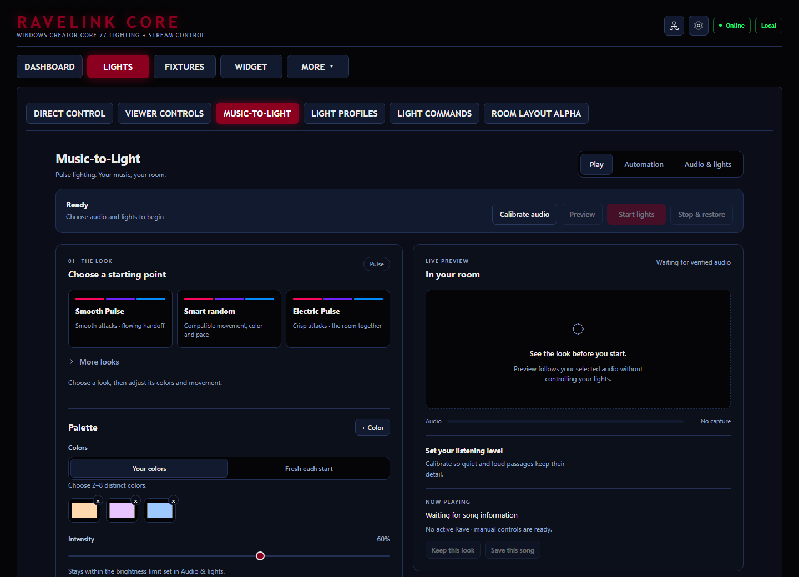
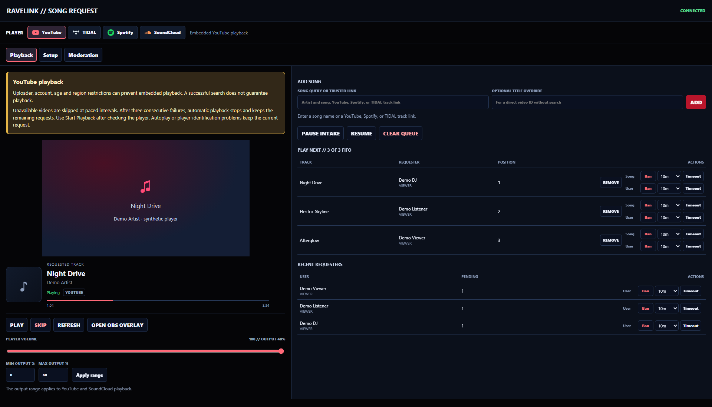
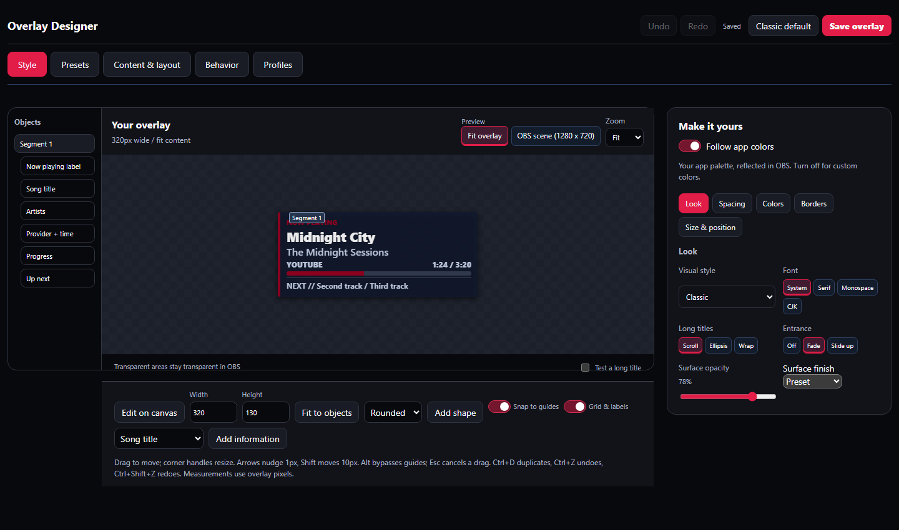
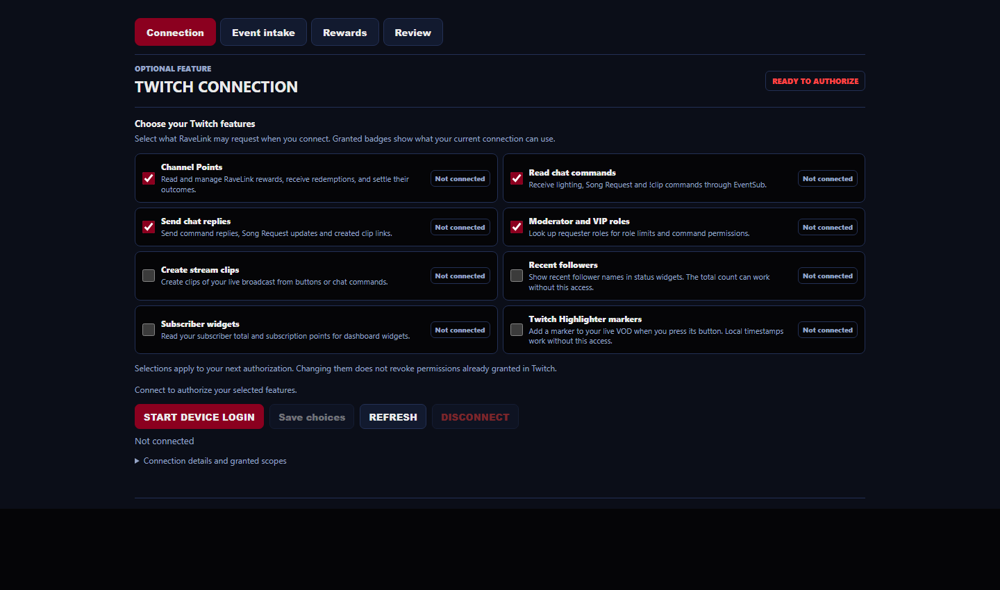

# RaveLink Core

**Your music, lights and Twitch controls in one Windows app.**

- Control compatible **Hue, WiZ and Govee LAN lights**.
- Make your lights react to music with **Music-to-Light**.
- Build a **button deck** for music, volume, OBS and lighting.
- Let Twitch viewers **request songs and change your lights**.

Twitch and Song Request are optional. Local lighting works without them.

[Download 0.7.6b](https://github.com/NameSRoby/RaveLink-Core/releases/tag/v0.7.6b) |
[User guide](docs/USER_GUIDE.md) |
[Report a bug](https://github.com/NameSRoby/RaveLink-Core/issues/new?template=bug_report.yml)

## Install

1. Download **RaveLink-Core-Windows-v0.7.6b-setup-installer.exe**.
2. Run Setup and choose the features you want.
3. Open **RaveLink Core** from the Start menu or desktop shortcut.

**Portable:** extract **RaveLink-Core-Windows-v0.7.6b-self-contained.zip** completely,
then run **RaveLink-Core.exe**.

The runtime and optional packages are included. No developer tools are needed.
Your account sign-ins and online music services still need internet.

Windows requirements and other installation options

- **Windows 10 x64, build 19041 or later**, or Windows 11.
- Music-to-Light app capture needs **build 20348 or later**; Windows 11 is recommended.
- Setup installs WebView2 when needed. Portable users can run its included installer
  from **optional-components/prerequisites**.
- The release is unsigned, so Windows may show an unknown-publisher warning.
  Compare downloads with **SHA256SUMS.txt**.
- **Code > Download ZIP** downloads source code. Run **Start-RaveLink.cmd** for
  first-time source setup; it downloads a verified runtime bundle.
- Use a separate folder from an old RaveLink Bridge installation.

[Windows setup guide](docs/WINDOWS_SETUP.md) |
[Source setup](docs/USER_GUIDE.md#source-and-tests)

## Start here

| Want to...                  | Open                                         |
| --------------------------- | -------------------------------------------- |
| Connect your lights         | **Fixtures**                                 |
| Make lights follow music    | **Lights > Music-to-Light > Audio & lights** |
| Add Twitch or song requests | **Packages**                                 |
| Customize your controls     | **Dashboard > Button deck > Edit**           |
| Use your phone or tablet    | The **network icon**                         |

Core opens in its own desktop window. You can also use
[localhost:5050](http://127.0.0.1:5050) in a browser.
Closing the window keeps Core in the tray; **RaveLink > Exit** stops it.

## Build your button deck

Put your most-used controls on one screen:

- **Music:** playback, volume and request moderation.
- **Lights:** colors, saved profiles and Rave controls.
- **OBS:** scenes, source visibility, microphones and filters.
- **Custom actions:** keyboard shortcuts, macros and approved mod functions.

Press **+** to add a button. Use **Edit** to move it or change its appearance.
Add pages and folders when you need more space.

Choose icons, text, images, GIFs and backlight colors.
Use **Fullscreen** for a dedicated control surface on desktop, phone or tablet.

[Button deck setup and customization](docs/CONTROL_DECK.md)

See the OBS button builder

Connect through **OBS connection**, then choose **Create an OBS button** in the
button editor. OBS 28+ includes the required WebSocket server.

[OBS setup](docs/CONTROL_DECK.md#obs-buttons)

## Make your lights follow music

1. Open **Audio & lights** and choose your audio source and lights.
2. Allow capture and light output, then calibrate at your usual listening volume.
3. Open **Play**, choose an effect profile and preview it.

Choose matching, custom or random colors. Use **Create** for detailed tuning
and saved effects.

[Music-to-Light guide](docs/USER_GUIDE.md#music-to-light) |
[Hue setup](docs/USER_GUIDE.md#hue-entertainment-setup) |
[Govee compatibility](docs/USER_GUIDE.md#govee-lan-compatibility)

## Take song requests

Install **Song Request** from **Packages**, choose a player and follow its Setup page.

Manage requests, moderate viewers and songs, organize playlists, review transfers
and design a now-playing overlay for OBS.

| Player     | How it connects                                      |
| ---------- | ---------------------------------------------------- |
| YouTube    | Search and official embedded playback                |
| SoundCloud | Public search and official widget playback           |
| Spotify    | Desktop companion; optional Premium account controls |
| TIDAL      | Signed-in catalog and desktop companion              |

Availability, accounts, ads and playback restrictions depend on the provider.
Desktop companions may need updating after player changes.

[Player setup and limitations](docs/USER_GUIDE.md#optional-features) |
[Playlists and transfers](docs/USER_GUIDE.md#playlists-and-transfers)

See the overlay designer

Select an object, adjust its layout and choose **Save overlay** to apply changes to OBS.

## Connect Twitch

Install **Twitch Integration** from **Packages** and connect your account.
Choose which permissions you want before signing in.

You can enable:

- Song requests through Channel Points or **!sr / !songrequest**.
- Viewer lighting commands and Rave.
- Chat replies and stream clipping.

Core-managed song rewards stay refundable until playback is confirmed.
Widget-only intake requires manual refunds and fulfillment.

See Twitch permission settings

Permission changes apply to your next sign-in. Unchecking an option does not
revoke permissions already granted on Twitch.

[Community playlist rewards](docs/USER_GUIDE.md#community-playlist-reward)

## Use a phone or tablet

Click the **network icon** to enable access on your private network.
Scan the QR code or copy the link to your other device.

Private-network access gives that device full controls.
The desktop window and localhost remain available.

## What's new in 0.7.6b

- More memory headroom for Song Request and Twitch.
- Delayed requests time out without shutting down the integration.
- A visible crash warning with a link to Packages for recovery.

Update **Song Request to 0.45.12** and **Twitch Integration to 0.12.10** in Packages.

[Full release notes](https://github.com/NameSRoby/RaveLink-Core/releases/tag/v0.7.6b) |
[Earlier releases](https://github.com/NameSRoby/RaveLink-Core/releases)

## Things to know

- Light features depend on the model, firmware and network. Hue Entertainment
  needs pairing and an area; compatible Govee lights need LAN Control enabled.
- Protected audio may be unavailable. Browser capture does not isolate individual tabs.
- Stop and normal shutdown attempt to restore your lights. A crash, power loss or
  disconnected device can prevent restoration.
- Community mods are third-party code. Review them before activation.

Screenshots use demonstration data and simulated connections.
Automated tests cannot certify every device or account.

[User guide](docs/USER_GUIDE.md) |
[Validation and known limits](docs/REPOSITORY_HEALTH.md)

## Privacy and updates

Settings, credentials, pairings, playlists and logs stay on your PC and are
excluded from published downloads. Services you enable still use the internet.

Updates verify checksums and preserve local data.
Optional packages update separately under **Packages**.

When reporting a bug, include your versions and steps to reproduce it.
Remove tokens, account details and private paths from screenshots and logs.

## Developers and contributors

[Contributing](CONTRIBUTING.md) |
[Developer guide](docs/DEVELOPMENT.md) |
[Mod author guide](docs/MOD_AUTHOR_GUIDE.md) |
[Mod APIs](docs/MOD_API_REFERENCE.md) |
[Application APIs](docs/API_REFERENCE.md) |
[Mod starter](packages/mod-sdk/starter)

## License

Apache-2.0. Third-party code and provider marks retain their own licenses.
See [LICENSE](LICENSE) and [THIRD_PARTY_NOTICES.md](THIRD_PARTY_NOTICES.md).
